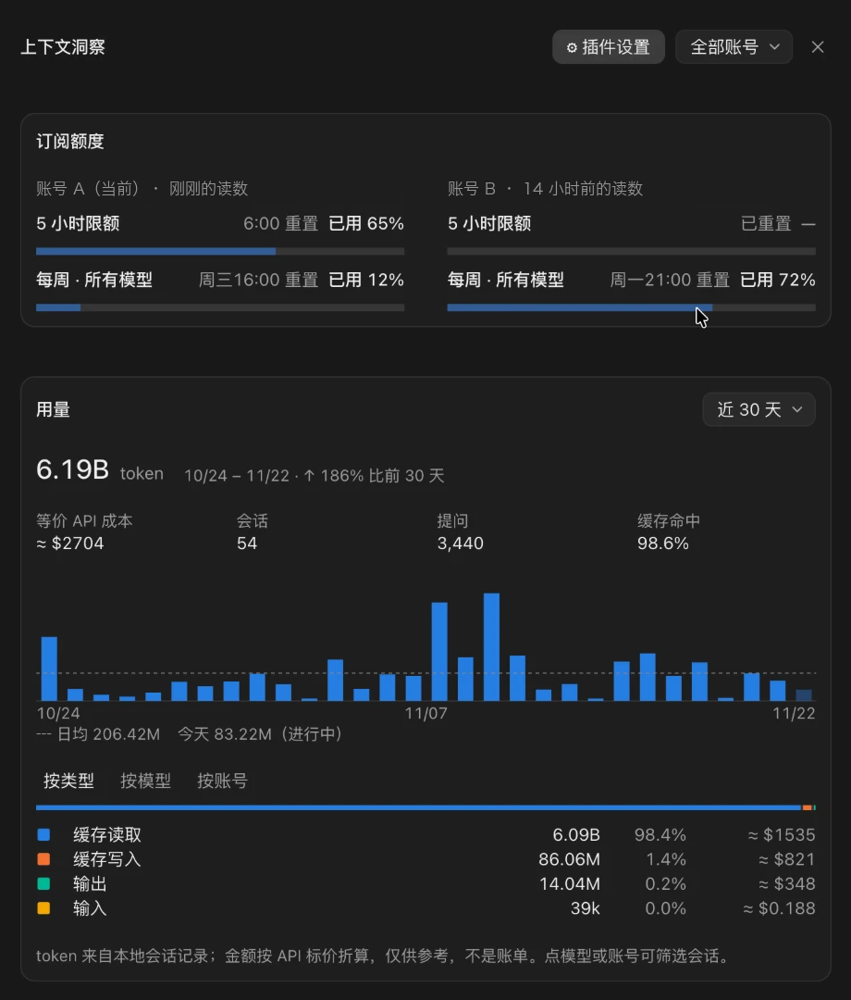

# 上下文洞察（cc-context-insights）

> 非官方插件，专为 Claude Code / Claude Desktop 设计，与 Anthropic 无关联。

在 Claude Code 旁边打开一个面板，一眼看清三件事：**订阅额度还剩多少、最近用了多少 token、哪些会话在消耗它们**。所有数据都从你本机的会话记录里读取，在本机计算，不上传。

 

## 面板里有什么

面板是一整页，从上往下依次是：

- **订阅额度**：每个账号的 5 小时限额与每周限额，写成「已用 x%」并标出重置时刻。用到 80% 变黄、95% 变橙。当前账号是实时读数，其他账号显示最后一次读数，并注明是多久以前的。账号多时自动并排，面板窄了自动换行。
- **用量**：以 token 为主，金额为辅。
  - 主数字是所选时间段的 token 总量，旁边是日期范围和环比
  - 下面一排小指标：等价 API 成本、会话数、提问数、缓存命中率
  - 每日柱状图：虚线是日均，今天还没过完的柱子画浅色；鼠标移到柱子上立即显示当天明细
  - 构成表：按类型 / 按模型 / 按账号切换，列出 token、占比和等价金额；点模型或账号可筛选下面的会话
  - 时间范围在卡片右上角选：今天、昨天、近 7 天、近 30 天、本月、上月、全部时间
- **会话**：以项目为主线。每个项目一行，点开列出它的会话（每页 6 个），可以搜索标题、项目或最后一条消息，按时间或 token 排序。每个会话写着累计 token 和最后一条消息；点标题，属于当前登录账号的会话在 Claude Desktop 里打开，其余复制带 `cd` 的恢复命令。

顶栏右侧是「插件设置」和账号筛选。设置页可以给账号起显示名、排除不想统计的项目、隐藏所有金额、重新扫描日志。

## 使用

安装后新开一个会话，面板会自动打开。

- `/ctx`：打开面板，顺带增量扫描会话日志
- `/ctx full`：查看当前会话的上下文占用，并做一次精确统计
- `/ctx close`：关闭面板。也可以点面板右上角的 ✕，或在面板里按 Esc

桌面端和 VS Code 用图表显示，终端用文字条显示。

## 安装

从 GitHub 安装：先添加插件市场，再安装插件。

```bash
claude plugin marketplace add istracker/claude-context-insights
```

```bash
claude plugin install cc-context-insights@cc-context-insights
```

在 Claude Code 会话里也可以分别运行 `/plugin marketplace add istracker/claude-context-insights` 和 `/plugin install cc-context-insights@cc-context-insights`。

从本地克隆的仓库安装（改代码后执行 `/reload-plugins` 生效）：把第一条命令里的 `istracker/claude-context-insights` 换成仓库所在目录的路径，第二条不变。

## 数据从哪来、去哪里

- **读取**：本机 `~/.claude/projects` 下的会话日志（支持 `CLAUDE_CONFIG_DIR`），以及 Claude Desktop 的会话索引 `claude-code-sessions`，用来标注每个会话属于哪个账号。订阅额度读取自 Claude 客户端。
- **保存**：扫描结果和设置只存在插件自己的本地存储里。首次全量读取，之后只读新增部分。
- **不上传**：插件不发起任何网络请求，所有计算都在本机完成。

## 口径说明

- **token 是准确值**：按每条消息的 `usage` 字段累计，一次响应在日志里拆成多行时按 `requestId` 去重。
- **金额是估算，不是账单**：「等价 API 成本」按各模型的 API 标价折算。订阅用户不按它计费，真正的上限看订阅额度。进行中的会话按同模型的单价估算，标「≈」。
- **未归属**：在终端直接运行的 CLI 会话不在 Desktop 的会话索引里，无法对应到账号，记为「未归属」。

## 局限

- 插件面板在 Claude Desktop 里显示在名为「插件」的标签下，这个标签名由 Desktop 决定，插件改不了。
- Desktop 标签上的 × 和 `Cmd+\` 目前关不掉插件面板，请用面板里的 ✕、Esc 或 `/ctx close`。
- 插件无法让 Claude Desktop 切换到另一个账号的会话；这类会话点标题会复制恢复命令。

## 致谢

功能设计参考 [dsh-context](https://github.com/bowenliang123/dsh-context)（Apache-2.0），配色取自 Claude 自带的上下文用量界面。

## 许可

MIT
